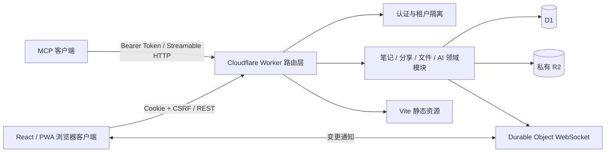

# EasyNote 项目说明

> 本文是 EasyNote 的开发者架构入口。开始修改代码前，请先阅读本文，再按改动范围继续阅读对应源码、测试和专题文档。用户功能和部署操作以 [`README.md`](README.md) 为准；AI 接入和灾备分别以 [`docs/AI_INTEGRATION.md`](docs/AI_INTEGRATION.md) 与 [`docs/DISASTER_RECOVERY.md`](docs/DISASTER_RECOVERY.md) 为准。

## 1. 项目定位

EasyNote 是面向个人或小团队的自托管 Markdown 笔记应用，当前版本为 `0.7.8`。它是上层 `easy_suite` Git 仓库中的一个子项目，本目录自身不是独立 Git 根目录。

核心技术栈：

- 前端：React 19、TypeScript、Vite、CodeMirror 6。
- Markdown：markdown-it、DOMPurify、highlight.js、Mermaid。
- 离线与 PWA：IndexedDB、Service Worker、vite-plugin-pwa。
- 服务端：Cloudflare Worker。
- 数据：D1 保存账号和笔记数据，私有 R2 保存图片与附件。
- 实时同步：Durable Object WebSocket 通知，增量同步和轮询兜底。
- AI：同一 Worker 暴露远程 MCP 端点，使用独立的受限令牌。
- 测试：Node Test Runner、Miniflare、Playwright。

## 2. 总体架构



请求统一进入 `src/worker/index.ts`：

1. 非 `/api/*`、非 `/mcp` 请求交给静态资源绑定 `ASSETS`，SPA 未命中时回退到 `index.html`。
2. `/api/public/shares/*` 是只读公开分享入口。
3. 登录、注册、会话和账号管理由 `authRoute` 处理。
4. `/api/integrations/tokens*` 使用浏览器会话；`/api/integrations/*` 使用 AI Bearer Token。
5. 其余 API 先验证浏览器会话，再依次进入功能、笔记和文件路由。
6. `/mcp` 将 MCP 请求映射到内部 AI 集成 API，不绕过服务端鉴权和领域校验。
7. 每小时第 17 分钟触发清理任务，处理过期状态和未引用对象。

## 3. 目录职责

```text
easynote/
├── src/
│   ├── client/       浏览器 UI、编辑器、离线状态、导入导出、PDF
│   ├── worker/       Worker 入口、认证、领域 API、实时事件和清理任务
│   ├── ai/           MCP Server 定义及其内部 API 客户端
│   └── shared/       浏览器、Worker、MCP 共用的类型和纯函数
├── migrations/       D1 基线 Schema、索引、FTS5 和触发器
├── scripts/          初始化、部署、Cloudflare 资源和灾备实现
├── test/             API、AI、脚本、合并算法和浏览器集成测试
├── docs/             AI 接入、灾难恢复等专题文档
├── examples/         Markdown 和 Mermaid 示例
├── public/           PWA 图标、字体和静态响应头
├── *.sh              面向用户的本地开发、部署和维护入口
├── wrangler.json     Worker、D1、R2、DO、Cron 和运行参数
├── vite.config.ts    前端构建、PWA 缓存、开发代理和代码分包
└── package.json      Node 版本、依赖及检查/测试命令
```

### 3.1 前端 `src/client`

- `main.tsx`：React 挂载入口。
- `App.tsx`：顶层应用壳和主要页面状态；包含登录/注册、工作台、设置、对话框、任务中心、版本历史、导入导出及响应式布局。它是 UI 编排层，不承担持久化规则。
- `useNotebook.ts`：笔记领域的前端状态中心。负责列表和当前笔记、文件夹筛选、自动保存、本地草稿、增量同步、WebSocket/轮询、三方合并、冲突处理、离线镜像、标签批量操作和文件缓存。
- `api.ts`：浏览器 API 边界。统一设置同源凭据、客户端 ID、CSRF、超时和未授权处理；文件上传单独使用较长超时。
- `drafts.ts`：IndexedDB 数据层。按用户隔离草稿、离线笔记镜像、会话摘要、同步游标和缓存文件；写入通过队列串行化。
- `merge.ts`：纯三方合并算法。标量、标签和文本分别合并，不能安全自动合并时显式返回冲突字段。
- `Editor.tsx`：CodeMirror 编辑、快捷操作、安全 Markdown 渲染、任务勾选、代码高亮和按需 Mermaid 渲染。
- `transfer.ts`：EasyNote ZIP、Obsidian/通用 Markdown 导入，附件重映射、重复检测与数据校验。
- `pdf.ts`：将预览 DOM 转换为 pdfmake 文档，处理图片/Mermaid、字体、分页预览和平台导出。
- `knowledge.ts`：标题提取及稳定的内部笔记链接。
- `i18n.ts`：中英文词典和运行时语言切换；键一致性由脚本检查。
- `AccountSecurity.tsx`、`UserManagement.tsx`、`AiAccess.tsx`、`NoteSharing.tsx`、`ShareManagement.tsx`：设置页中的独立功能面板。
- `styles.css`：全局视觉系统和桌面/移动响应式样式。

前端最关键的数据流：

```text
用户编辑
  → useNotebook 立即更新内存状态
  → drafts.ts 持久化本地草稿
  → AUTOSAVE_MS 后 api.save(revision, operationId)
  → Worker 进行乐观并发检查
  → 成功：刷新本地镜像并清理草稿
  → 409：以编辑起点、当前本地内容、远端内容进行三方合并
      → 可安全合并：重新提交
      → 重叠冲突：交给用户选择或另存冲突副本
```

离线库默认开启。客户端用增量游标同步 D1 的权威状态，WebSocket 只发送“数据已变化”的提示，收到提示后仍通过 API 拉取数据。WebSocket 断开时，定时轮询、页面重新可见和网络恢复会继续兜底。

### 3.2 Worker `src/worker`

- `index.ts`：唯一请求入口、模块编排、统一错误响应和 Cron 入口。
- `core.ts`：`Env` 绑定、运行参数验证、JSON/字节读取限制、摘要和通用 `ApiError`。
- `auth.ts`：初始化管理员、会话 Cookie、CSRF/Origin、登录限流、注册审批、恢复代码、账号安全和管理员用户管理。
- `notes.ts`：笔记 CRUD、分页/搜索、标签、版本、回收站、墓碑、附件引用、幂等操作、乐观并发和增量同步。
- `folders.ts`：按租户隔离的嵌套文件夹 CRUD、同级重名和循环校验，以及删除文件夹树时的笔记保留策略。
- `images.ts`：图片/附件上传下载、类型和大小校验、R2 配额预留、对象状态转换及清理。
- `features.ts`：任务中心、分享管理和公开只读分享。
- `integrations.ts`：AI 令牌管理、AI 身份、统计、搜索、批量读取和受控写入。
- `mcp.ts`：将远程 MCP Server 接到同一 Worker，并复用集成身份和领域 API。
- `events.ts`：按用户 ID 分片的 Durable Object WebSocket；排除发起变更的客户端后广播通知。

服务端的关键不变量：

- 所有私有查询必须包含 `user_id`；R2 Key 以用户 ID 分区。
- 浏览器写请求必须同时通过会话、Origin 和 CSRF 检查。
- AI 访问只接受哈希存储、可撤销、可过期且区分只读/读写的 Bearer Token。
- `revision` 防止静默覆盖，`operationId + mutation_hash` 保证重试幂等。
- 自动保存不新增历史；手动检查点和 AI 写入才建立版本快照。
- 永久删除会写入 `purged_notes` 墓碑，阻止旧设备重新创建已清除笔记。
- 笔记正文引用的文件必须已经属于当前用户且处于 `ready` 状态。
- HTTPS 为默认强制条件，只有显式配置的本机环回开发环境允许 HTTP。

### 3.3 AI `src/ai`

`src/ai/index.ts` 创建 MCP Server，提供搜索、最近笔记、文件夹列表、单篇/批量读取、连接状态、精确统计和按 URI 读取的 Resources。读写令牌还可获得创建/更新笔记、创建/改名/移动/删除文件夹、归档和移入回收站工具；AI 不提供永久删除笔记的能力。

`src/ai/client.ts` 是 MCP 工具到 `/api/integrations/*` 的窄客户端，负责 URL/令牌格式校验、Bearer 鉴权、超时和错误保真。AI 写入始终带预期 revision，并由 Worker 写入正常版本历史。

### 3.4 共享层 `src/shared`

- `types.ts`：跨运行时数据契约、ID/指纹规则、笔记输入规范化、内部文件/笔记链接解析和内容指纹。
- `tasks.ts`：从 Markdown 中提取未完成任务的纯函数。
- `version.ts`：构建时注入的应用版本。

共享层不得依赖 DOM、React 或 Cloudflare 运行时专属对象，以便浏览器、Worker 和测试共同复用。

## 4. 数据模型和存储边界

`migrations/0001_initial.sql` 建立 D1 基线，后续按编号依次应用 migration；`0002_folders.sql` 增加嵌套文件夹和笔记/版本的文件夹归属：

| 表/对象 | 作用 |
| --- | --- |
| `users` | 租户账号、角色、启停、审批、恢复和删除状态 |
| `sessions` | 哈希后的会话令牌、CSRF 和过期时间 |
| `integration_tokens` | AI 令牌元数据、权限、过期和撤销状态 |
| `login_attempts` / `account_attempts` | 登录、注册和重置等限流窗口 |
| `app_state` | 全局注册开关 |
| `folders` | 用户私有的嵌套文件夹、父子关系和同级唯一名称 |
| `notes` | 当前笔记状态和并发/幂等字段 |
| `note_versions` | 有上限的手动/AI 内容快照及操作者信息 |
| `images` | R2 对象元数据；同时表示图片与普通附件 |
| `image_refs` | 当前或历史 revision 对文件的引用 |
| `purged_notes` | 永久删除墓碑 |
| `note_changes` | 按用户递增的离线增量同步日志 |
| `note_shares` | 每篇笔记最多一个只读分享 Token 哈希 |
| `notes_fts` | 基于 trigram tokenizer 的 FTS5 索引 |

FTS 由数据库触发器跟随 `notes` 的新增、更新和删除维护。文件夹通过自引用外键组成树，禁止跨租户父子关系、同级重名和循环移动。完全空白的正常笔记通过部分唯一索引限制为每位用户每个文件夹最多一篇（根目录单独计算）。删除文件夹树时，非空笔记保留并移动到根目录，完全空白笔记进入回收站。

R2 只保存私有二进制对象；D1 保存对象元数据、哈希、尺寸、状态和引用。上传先写 `pending` 元数据并预留配额，R2 成功后转为 `ready`。定时任务清理失败上传、超过宽限期且未被当前/历史版本引用的文件，以及已申请删除账号的数据。

浏览器 IndexedDB 不是服务端权威源，只是按用户分区的离线镜像与待提交草稿。恢复联网后仍需根据服务端 revision 合并。

## 5. 安全模型

- 密码不落明文；初始化配置和数据库仅保存带盐的 PBKDF2/HMAC 验证器。
- 会话令牌和分享/AI Token 在数据库中只保存摘要。
- 会话 Cookie 为 HttpOnly，并在生产环境要求 Secure；修改请求还需同源校验和 CSRF Header。
- 每个账号就是独立租户，笔记、版本、文件、同步日志、分享和 AI Token 均按用户隔离。
- 管理员操作保护“至少保留一名可用管理员”，管理员不能禁用、降级或删除自己。
- Markdown 中的 HTML 经过 DOMPurify；公开分享只读取指定笔记及其当前 revision 引用的文件。
- Service Worker 只缓存应用壳、PDF 引擎和字体，不缓存 `/api` 响应、Cookie 或私有正文。
- 远程部署和维护脚本只接受交互式隐藏输入的 Cloudflare Token，不把凭据保存到环境配置。

涉及这些边界的修改必须同时检查正向路径、越权路径、跨租户路径和过期/撤销路径。

## 6. 构建与运行

环境要求：Node.js `>=22.12`、npm、macOS 或 Linux Bash。依赖必须使用已锁定的 `package-lock.json`。

```bash
# 首次或常规本地运行；必要时交互式创建本地管理员
bash dev.sh

# Worker 已在 8791 运行时，另开 Vite HMR 前端
npm run dev:client
```

`dev.sh` 会检查运行时、使用 `npm ci` 准备锁定依赖、校验本地账号、执行完整构建、应用本地 D1 migration，再启动 Wrangler。默认地址是 `http://127.0.0.1:8791`。

重要配置来源：

- `wrangler.json`：生产默认使用 HTTPS，绑定 `ASSETS`、`DB`、`IMAGES`、`NOTE_EVENTS`，并定义大小、配额、版本保留、自动保存、轮询和限流参数。
- `.dev.vars`：忽略提交的本地管理员验证器和本地 HTTP 开关。
- `wrangler.deploy.json`：忽略提交的生产资源 ID，权限应保持 `0600`。
- `vite.config.ts`：读取上层仓库 `versions.json` 中的 `easynote` 版本；不要单独手改显示版本。

## 7. 测试架构与验证方式

测试运行时 `test/runtime.ts` 会用 esbuild 打包真实 Worker，启动隔离的 Miniflare D1/R2/DO 环境，按 migration 初始化 Schema，并创建测试账号和会话。API 测试不是路由 mock；它们验证真实 Worker 行为。

| 命令 | 覆盖范围 | 何时必须执行 |
| --- | --- | --- |
| `npm run check` | i18n 键一致性、应用 TypeScript、测试 TypeScript | 所有代码和配置改动 |
| `npm run test:api` | 认证、笔记、租户隔离、文件、同步、分享、合并单测 | Worker、共享模型、API 或同步逻辑改动 |
| `npm run test:ai` | 远程 MCP 鉴权、读取和写入工具 | `src/ai`、MCP 或集成 API 改动 |
| `npm run test:scripts` | 初始化、开发、部署、灾备和密码重置脚本 | Shell、`scripts/`、部署/维护配置改动 |
| `npm run test:ui` | Playwright 桌面/移动、离线、PWA、编辑和导入导出 | UI、样式、编辑器、离线或端到端行为改动 |
| `npm test` | `test:api` + `test:ai` | 合并前的服务端/AI 回归 |
| `npm run build` | 完整静态检查和 Vite/PWA 生产构建 | 所有准备提交的功能改动 |
| `bash deploy.sh --check` | 本地构建与 Wrangler 部署预检，不部署 | Worker 绑定或生产部署配置改动 |

推荐最小验证流程：

1. 文档改动：检查 Markdown 链接、命令和文件名，并运行 `npm run check` 确认文档没有掩盖已有工程问题。
2. 纯前端逻辑：`npm run check`、相关单测或 `npm run test:ui`、`npm run build`。
3. Worker/API：`npm run check`、`npm run test:api`、`npm run build`。
4. AI/MCP：在上一项基础上增加 `npm run test:ai`。
5. 脚本/部署：`npm run test:scripts`，再执行 `bash deploy.sh --check`。
6. 跨层或发布候选：`npm run check && npm test && npm run test:scripts && npm run test:ui && npm run build`。

测试失败时必须记录执行命令、首个有效错误和是否属于本次改动。不得用真实生产数据、远程部署或破坏性维护命令代替本地验证。

## 8. 修改指南

### 新增或修改 API

1. 先在 `src/shared/types.ts` 定义跨层契约（若仅服务端使用则留在领域模块）。
2. 在对应 `src/worker/*` 模块实现，并保持 `index.ts` 只做路由编排。
3. 在 `src/client/api.ts` 或 `src/ai/client.ts` 增加窄客户端方法。
4. 让 UI/Hook 只依赖客户端方法，不散落裸 `fetch`。
5. 为鉴权、输入边界、并发、幂等和跨租户隔离补 API 测试。

### 修改笔记保存或离线同步

必须同时审查：revision 递增、operationId 幂等、文件夹归属、历史版本策略、`note_changes` 游标、`purged_notes`、附件引用、IndexedDB 草稿、断网恢复、WebSocket/轮询兜底和三方合并。此链路不应以“最后写入获胜”简化。

### 修改数据库

不要直接重写已发布环境的结构假设。新增 migration 时保证文件名按顺序递增，并同步更新测试运行时可从空库依序应用的能力、灾备校验以及相关测试。Schema 仍应保留外键、租户索引和清理所需索引。

### 修改 UI 或文案

中英文必须同步更新 `i18n.ts`，并运行 `npm run check:i18n`。桌面与移动布局都要验证；涉及对话框时检查焦点、错误层级和键盘操作；涉及离线/PWA 时还需验证冷启动和网络切换。

### 修改文件或 Markdown 渲染

保持 MIME、字节数、像素、引用数量和配额的客户端体验校验与服务端强制校验一致。任何 HTML/Mermaid 变化都不得削弱净化边界；导入、导出、PDF 和公开分享可能需要同步回归。

## 9. 明确边界

- 不把 D1/R2 私有数据放入 Service Worker 静态缓存。
- 不在客户端信任租户 ID、权限、文件归属或 revision。
- 不绕过 `api.ts`/AI 客户端复制鉴权与错误处理。
- 不将 WebSocket 通知当作权威数据；通知后必须重新同步。
- 不把自动保存等同于历史检查点。
- 不允许 AI 永久删除数据。
- 不在非交互式参数、环境变量或仓库文件中传递生产密码/Token。
- 不手工编辑构建产物 `dist/`、依赖目录 `node_modules/` 或本地状态 `.wrangler/`。

理解或修改某个功能时，以本文作为地图，以对应源码和测试作为最终事实来源。
